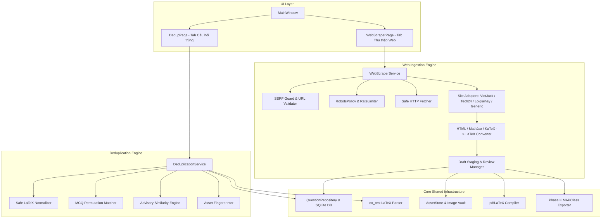

# MCPTest — BÁO CÁO PHÂN TÍCH HIỆN TRẠNG & THIẾT KẾ KIẾN TRÚC PHASE L
## L0 — Audit & Kiến trúc: Deduplication & Web Content Import

- **Dự án:** MCPTest (LaTeX Question Studio)
- **Nhánh:** `main`
- **Phiên bản:** Phase L0 Baseline
- **Ngày lập:** 14/10/2026

---

## 1. PHẠM VI VÀ MỤC TIÊU CỐT LÕI

Phase L bổ sung 2 tab độc lập cấp một vào ứng dụng MCPTest:
1. **Câu hỏi trùng (Deduplication):** Công cụ phát hiện, so sánh và quản lý các câu hỏi trùng lặp hoặc tương tự trong cả tệp nguồn `.tex` và Cơ sở dữ liệu SQLite hiện hữu.
2. **Thu thập từ Web (Web Scraper & Converter):** Hệ thống thu thập bài tập trực tuyến từ các trang web giáo dục được hỗ trợ hoặc văn bản generic, chuyển đổi công thức MathJax/KaTeX/HTML sang chuẩn LaTeX `ex_test`, tải và quản lý hình ảnh an toàn, kèm giao diện kiểm duyệt 2 cột trước khi nhập vào CSDL hoặc xuất đề theo chuẩn Phase K.

### 5 Nguyên tắc Bắt buộc (Non-negotiables):
- **Không tự động xóa câu hỏi trùng:** Mặc định không chọn xóa; mọi thao tác xóa đều phải do giáo viên chủ động tick chọn và xác nhận. Có kiểm tra ràng buộc khóa ngoại (FK) với đề thi và bài giảng đã lưu.
- **Không nhập nội dung web chưa qua kiểm duyệt:** Tất cả nội dung web thu thập được phải vào khu vực chờ (staging drafts) cho giáo viên rà soát, chỉnh sửa, xem trước trước khi ghi vào CSDL hoặc xuất đề.
- **Không báo xuất thành công nếu file `.tex` không biên dịch được:** Chỉ đánh dấu thành công khi trình biên dịch pdfLaTeX chạy không có lỗi và sinh ra file `.pdf` thực tế.
- **Không làm hỏng CSDL hiện tại:** Giữ nguyên vẹn schema version 19, không phá vỡ các bảng `questions`, `question_metadata`, `question_revisions`, `assets`, `lesson_files`.
- **Không tuyên bố hỗ trợ website khi adapter chưa được kiểm thử:** Tách biệt rõ các adapter đã kiểm thử với fixture thật (VietJack, Tech24, Loigiaihay, Generic). Nguồn bị từ chối/không hỗ trợ phải thông báo rõ ràng và cho phép người dùng dán nội dung thủ công.

---

## 2. HIỆN TRẠNG HỆ THỐNG VÀ CHIẾN LƯỢC TÁI SỬ DỤNG

### 2.1. Bộ phân tích cú pháp LaTeX (`parsing/latex.py`)
- **Hiện trạng:** Đã nâng cấp lên `PARSER_VERSION = 4` ở Phase K1, xử lý an toàn:
  - Trích xuất 4 loại câu: `mcq` (`\choice`), `true_false` (`\choiceTF`), `short_answer` (`\shortans`, `\dapsoTL`), `essay`.
  - Phân tích macro lồng nhau, comment, `\immini`, TikZ, loại trừ `\loigiai` và `\huongdan`.
- **Tái sử dụng cho Phase L:**
  - Làm nền tảng phân tích token/AST cho thuật toán phát hiện trùng lặp nhiều cấp (L2).
  - Làm bộ chuẩn hóa câu hỏi đầu ra của bộ chuyển đổi Web -> LaTeX (L4).

### 2.2. Kho lưu trữ tài nguyên hình ảnh (`application/assets.py`)
- **Hiện trạng:** Lớp `AssetStore` hỗ trợ content-addressed storage (`assets/<digest[:2]>/<digest>.<ext>`), staging batch `stage_bytes()`, kiểm tra checksum SHA-256 toàn vẹn. Lớp `AssetResolver` phân giải các lệnh `\includegraphics`.
- **Tái sử dụng cho Phase L:**
  - Quét fingerprint asset của câu hỏi trùng để so khớp ảnh theo nội dung bytes chứ không chỉ dựa vào tên file ảnh.
  - Nhận các ảnh raster/vector tải về từ web, lưu an toàn vào `AssetStore`, sinh đường dẫn tương đối `assets/...` và ngăn chặn đường dẫn độc hại (path traversal).

### 2.3. Bộ biên dịch pdfLaTeX (`preview/compiler.py`)
- **Hiện trạng:** Quản lý tiến trình biên dịch cô lập, tích hợp các gói lệnh `MAPClass.cls` và `ex_test.sty`, tự động tạo thư mục `Loigiai/` ngăn chặn lỗi `\Opensolutionfile`.
- **Tái sử dụng cho Phase L:**
  - Biên dịch preview cho các câu hỏi trùng khi so sánh cạnh nhau.
  - Biên dịch kiểm định tức thời các câu hỏi web draft trong chế độ review 2 cột.
  - Thực thi kiểm định nghiêm ngặt trước khi xuất đề thi từ web scraper.

### 2.4. Cấu trúc xuất đề Phase K (`application/exams.py`)
- **Hiện trạng:** Xuất đề chuẩn MAPClass 4 phần:
  - `\def\subject{...}` và `\TieudeT{...}`
  - `\PhanI` -> `\begin{cauhoiTN}{DeXX} ... \end{cauhoiTN}`
  - `\PhanII` -> `\begin{cauhoiDS}{DeXX} ... \end{cauhoiDS}`
  - `\PhanIII` -> `\begin{cauhoiTLN}{DeXX} ... \end{cauhoiTLN}`
  - `\PhanTL` -> `\begin{cauhoiTL}{DeXX} ... \end{cauhoiTL}`
  - Tự động bỏ qua phần rỗng, hỗ trợ gói ZIP di động và các file batch `bien-dich.bat`.
- **Tái sử dụng cho Phase L:**
  - Sử dụng chung hàm xuất đề cho tính năng xuất đề thi từ câu hỏi thu thập web.

---

## 3. THIẾT KẾ KIẾN TRÚC MÔ-ĐUN MỚI

### 3.1. Thuật toán phát hiện trùng 3 cấp (L2)
1. **Level 1 — Trùng khớp chính xác (Exact Normalized):**
   - Chuẩn hóa: Bỏ comment `%`, chuẩn hóa khoảng trắng thừa trong text (không làm hỏng khoảng trắng có nghĩa trong math), giữ nguyên mọi số, dấu âm/dương, mũ, điều kiện, công thức và ảnh.
   - Băm SHA-256 chuỗi chuẩn hóa để lập chỉ mục tìm kiếm siêu tốc $O(1)$.
2. **Level 2 — Trùng nội dung hoán vị phương án (MCQ Permutation):**
   - Chỉ áp dụng cho câu trắc nghiệm `mcq` có `\choice`.
   - Chuẩn hóa nội dung thân câu hỏi.
   - So khớp tập hợp 4 phương án: nếu 4 phương án giống hệt nhau về nội dung nhưng thứ tự xáo trộn khác nhau, **phải đối chiếu cờ `\True`**: Nếu cờ `\True` cùng chỉ vào phương án có nội dung như nhau thì xem là trùng lặp.
   - **Đối với `\choiceTF`:** TUYỆT ĐỐI không hoán vị 4 mệnh đề a, b, c, d khi so khớp. 4 mệnh đề phải đúng thứ tự từng ý.
3. **Level 3 — Gần trùng (Advisory Near-Duplicate Similarity):**
   - So khớp độ tương đồng token-set Jaccard và n-gram trên thân câu hỏi đã loại bỏ phương án.
   - Trả về điểm `similarity_score` (từ 0.0 đến 1.0) kèm lý do rõ ràng (ví dụ: *"Thân câu hỏi giống 92%, số liệu khác nhau"*).
   - Đánh dấu trạng thái **Cần xác nhận thủ công**; không bao giờ tự động coi là trùng chắc chắn.

### 3.2. An toàn Web Scraping & Chống SSRF (L3)
- **SSRF Guard:**
  - Kiểm tra URL hợp lệ (`http://` hoặc `https://`).
  - Phân giải DNS của hostname: Từ chối nếu IP thuộc dải loopback (`127.0.0.0/8`, `::1`), private networks (`10.0.0.0/8`, `172.16.0.0/12`, `192.168.0.0/16`, `169.254.0.0/16`), link-local hoặc multicast.
  - Ngăn chặn theo dõi chuyển hướng (redirect) dẫn tới địa chỉ nội bộ.
- **Tuân thủ & Lịch sự:**
  - Kiểm tra `robots.txt` trước khi gửi request.
  - User-Agent minh bạch: `MCPTest-QuestionStudio/1.0 (+https://github.com/letrieubavuong/MCPTest)`.
  - Rate limiting (tối thiểu 1 giây giữa các request cùng domain).
  - Timeout 10 giây, giới hạn dung lượng tải về tối đa 10MB/tệp.
  - Từ chối crawl tự động toàn site; chỉ nhận URL trang bài tập cụ thể. Nếu gặp paywall, captcha hoặc trang cấm bot thì báo lỗi từ chối và hướng dẫn người dùng sử dụng tính năng dán văn bản HTML/thô trực tiếp.

### 3.3. Chuyển đổi công thức Web sang LaTeX (L4)
- Hỗ trợ trích xuất từ:
  - Thẻ `<script type="math/tex">` của MathJax.
  - Thẻ `` hoặc `annotation encoding="application/x-tex"` của KaTeX.
  - MathML `<math>` cơ bản (`<mfrac>`, `<msup>`, `<msqrt>`).
  - Các thẻ HTML thường dùng trong toán học: ``, ``, `<i>`, `<b>`, bảng `<table>`.
- Chuyển đổi ký tự toán học Unicode (ví dụ: `∈`, `∉`, `⊂`, `∪`, `∩`, `√`, `π`, `α`, `β`, `Δ`, `≤`, `≥`, `≠`, `→`, `∞`) sang các macro LaTeX tương ứng (`\in`, `\notin`, `\subset`, `\cup`, `\cap`, `\sqrt`, `\pi`, `\alpha`, `\beta`, `\Delta`, `\le`, `\ge`, `\ne`, `\to`, `\infty`).
- Tự động chuẩn hóa ảnh: Tải về, kiểm tra định dạng ảnh hợp lệ, lưu vào `AssetStore`, sinh macro `\includegraphics[...]{assets/...}` tương thích.

---

## 4. MA TRẬN RỦI RO & PHƯƠNG ÁN XỬ LÝ

| Rủi ro | Mức độ | Phương án phòng ngừa & Xử lý |
| :--- | :--- | :--- |
| Xóa nhầm câu hỏi đang được dùng trong đề thi hoặc bài giảng | **Nghiêm trọng (P0)** | Kiểm tra ràng buộc khóa ngoại (foreign references) trước khi xóa. Nếu câu đang được tham chiếu, hiển thị cảnh báo và từ chối xóa hoặc yêu cầu gỡ liên kết trước. Mọi thao tác xóa phải chạy trong SQLite transaction và có thể rollback. |
| Treo UI khi quét trùng lặp trên CSDL lớn (10.000–50.000 câu) | **Cao (P1)** | Đưa tác vụ quét sang luồng nền (`QThread` / `Job`), phân trang theo batch 1.000 câu, báo cáo tiến độ qua signal `%`, có nút Hủy tác vụ an toàn. |
| Tấn công SSRF hoặc truy cập tệp nhạy cảm hệ thống qua URL | **Nghiêm trọng (P0)** | Triển khai bộ lọc `SSRFGuard` chặn mọi IP nội bộ, loopback, private IP, kiểm tra DNS resolution trước khi kết nối HTTP. |
| Trang web thay đổi cấu trúc DOM khiến trích xuất sai câu | **Trung bình (P2)** | Thiết kế kiến trúc Adapter độc lập, có `GenericArticleAdapter` dự phòng; tất cả câu trích xuất phải đưa vào Draft Staging cho giáo viên xem trước và biên tập, không tự động lưu vào CSDL. |
| Xuất file TeX từ web bị lỗi cú pháp pdfLaTeX | **Cao (P1)** | Tích hợp bộ biên dịch `Compiler` kiểm tra cú pháp trước khi xuất; chỉ thông báo "Xuất thành công" khi file PDF thực sự được tạo ra và không có lỗi nghiêm trọng. |

---

## 5. KẾ HOẠCH BƯỚC ĐI TIẾP THEO

- **L1 & L2:** Triển khai `DeduplicationService` (`src/latex_question_studio/application/dedup.py`) và Tab `DedupPage` (`src/latex_question_studio/ui/pages/dedup_page.py`) kèm test suite `tests/test_phase_l_dedup.py`.
- **L3 & L4:** Triển khai `WebScraperService` (`src/latex_question_studio/scraping/`) và Tab `WebScraperPage` (`src/latex_question_studio/ui/pages/web_scraper_page.py`) kèm test suite `tests/test_phase_l_scraper.py`.
- **L5 & L6:** Kiểm thử E2E tích hợp vào `MainWindow`, kiểm thử biên dịch pdfLaTeX thật, chạy benchmark hiệu năng và lập báo cáo `docs/PHASE_L_DATA_TOOLS_REPORT.md`.
